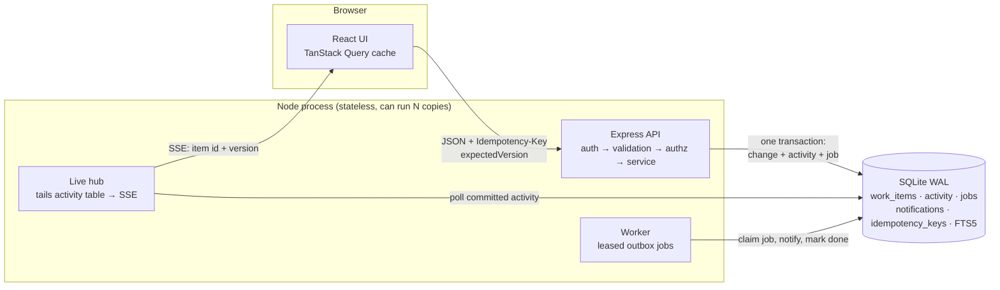

# OpsDesk

An internal web application for coordinating operational work — customer issues, payment investigations, incidents, compliance requests, approvals — across many teams. Built for the Newtonite *Operations Under Pressure* challenge.

People can see at a glance what needs attention, take ownership of work without colliding with each other, move it through a workflow with approvals, discuss it, and see exactly what happened and why.

- **Stack:** React 19 + TanStack Query (Vite) · Node.js + Express 5 · SQLite (WAL, FTS5) via better-sqlite3
- **Decisions and trade-offs:** see [ENGINEERING_DECISIONS.md](ENGINEERING_DECISIONS.md)
- **Tests:** 44 automated tests focused on the behaviours that would be dangerous if wrong

---

## Running it

Requires **Node.js 20.19+ or 22+** (npm included). No other services.

```bash
npm run setup     # installs server and client dependencies
npm start         # builds the UI, seeds a demo database on first run, serves everything
```

Open **http://localhost:4000**. The first start seeds ~20,000 work items with history (about 2 seconds).

For development with hot reload:

```bash
npm run dev       # API on :4000 (auto-restart), Vite on :5173 (proxies /api) → open http://localhost:5173
```

Other commands:

| Command | What it does |
|---|---|
| `npm test` | Runs the server test suite (`node --test`) |
| `npm run seed` | Deletes and re-seeds the demo database. Volume: `npm --prefix server run seed -- --items 100000` |
| `npm --prefix server run worker` | Runs the background worker as a separate process (start the API with `RUN_WORKER=0`) |

Environment variables (all optional): `PORT` (4000), `DB_FILE` (`server/data/opsdesk.db`), `SEED_ITEMS` (20000), `RUN_WORKER` (1), `NODE_ENV=production` (secure cookies, hides demo-account list).

### Demo accounts

Every account's password is `password`. The sign-in screen lists them with one-click sign-in.

| Account | Roles | Use it to see |
|---|---|---|
| alice@opsdesk.test | Global admin | Everything, every team |
| ben@opsdesk.test | Payments **lead**, Support member | Assigning, approving, rejecting |
| priya@opsdesk.test | Payments **lead**, Compliance lead | A *second* lead for separation-of-duties approvals |
| chen@opsdesk.test | Payments member | Day-to-day work: claim, edit, resolve |
| dana@opsdesk.test | Payments member, SRE member | Racing Chen for the same item |
| sam@opsdesk.test | SRE lead, Engineering member | A different team's view |
| omar@opsdesk.test | Support member only | Payments items are invisible (404) |
| vic@opsdesk.test | Viewer on Payments, Support, SRE | Read and comment only |

---

## A five-minute walkthrough of the interesting parts

Open two browsers (or a normal and a private window) and sign in as **Chen** and **Dana**.

1. **Claim race.** Both open the same item from *Unassigned urgent*. Chen clicks **Take this item**. Dana's screen updates live (the button disappears, Chen is shown as owner). If Dana clicks before her screen updates, the server refuses: *"Chen Member took this item just before you."* Exactly one claim is ever recorded.
2. **Stale edits.** Chen and Ben (lead) both click **Edit** on the same item.
   - If they change *different* fields (Ben the priority, Chen the description), Chen's save is merged automatically on top of Ben's.
   - If they change the *same* field, Chen sees a banner while still editing, and on save is asked field by field: *Keep theirs / Keep mine*. Nothing is overwritten silently.
3. **Approval workflow.** On a *Payment* item, Chen can't resolve it — only **Request approval**. Ben or Priya sees it under *Awaiting my approval*. A lead who is also the assignee cannot approve their own work.
4. **Access.** Open the same item URL as **Omar**: "doesn't exist or isn't in one of your teams". As **Vic**: readable, commentable, no action buttons — and the server rejects those actions even if called directly.
5. **History and notifications.** Every change appears in the item's history with who, what and when. The reporter gets an *Inbox* notification produced asynchronously by the background worker.
6. **Lists stay put.** While you look at a list, other people's changes show as *"3 changes by others since this list loaded. Refresh"* instead of rows jumping under your cursor.

Keyboard: `c` new item · `j`/`k` move through the list · `Esc` close the detail panel.

---

## Architecture



**A write, end to end** (e.g. "resolve this item"):

1. The browser sends `POST /api/items/42/transition {to, expectedVersion: 7}` with an `Idempotency-Key`.
2. The server authenticates (cookie session), validates the body (zod), loads the item **only if the user's team can see it** (otherwise 404), checks the workflow rule table and the caller's role, then runs `UPDATE … WHERE id = 42 AND version = 7`.
3. In the **same transaction** it appends an `activity` row, enqueues a `notify` job, and stores the response under the idempotency key. Either all of it commits or none of it does.
4. The response returns the new item (version 8). The client replaces its optimistic state with it.
5. Within ~0.5 s the live hub sees the new activity row and pushes `{itemId: 42, version: 8}` to every connected browser allowed to see that team; they refetch through the normal API.
6. The worker leases the job, writes notifications (deduplicated by a unique key), and marks it done — with retries, backoff and a dead-letter state if it keeps failing.

### Repository layout

```
server/
  src/
    schema.sql           tables, indexes, FTS triggers
    db.js                connection, WAL, transactions (BEGIN IMMEDIATE)
    auth.js              password hashing, sessions
    authz.js             role model and every permission rule
    workflow.js          state machine: who may move an item where, and when
    idempotency.js       Idempotency-Key handling, committed with the change
    services/items.js    commands: create, update, claim, assign, release, transition, comment
    services/queries.js  list (filters, search, keyset pagination) and dashboard
    worker.js            transactional outbox processor
    live.js              Server-Sent Events fan-out
    routes/api.js        HTTP layer: validation and routing only
    seed.js              demo data generator
  test/                  node:test + supertest
client/
  src/
    lib/api.js           fetch wrapper, idempotency keys, retry policy
    lib/live.jsx         SSE subscription → cache invalidation
    lib/useItemAction.js optimistic actions reconciled with server answers
    pages/               Dashboard, Work (list + detail), Login
    components/          ItemDetail (edit/conflict handling), Timeline, CreateItemModal, …
```

### API summary

All endpoints are under `/api`, return JSON, and report errors as `{ error: { code, message, details } }` with stable codes (`VERSION_CONFLICT`, `ALREADY_CLAIMED`, `APPROVAL_REQUIRED`, `IDEMPOTENCY_KEY_REUSED`, …).

| Method & path | Purpose |
|---|---|
| `POST /auth/login`, `POST /auth/logout`, `GET /me` | Session |
| `GET /teams`, `GET /teams/:id/members` | Teams the caller can see, and who can be assigned |
| `GET /dashboard` | Attention counts and active work per team |
| `GET /items?status=&priority=&type=&assignee=me\|unassigned\|id&teamId=&q=&overdue=1&awaitingMyApproval=1&sort=updated\|priority\|due\|created&cursor=&limit=` | Filtered, searchable, cursor-paginated list |
| `GET /items/:id`, `GET /items/:id/activity?before=` | Item with the caller's permissions; paginated history |
| `POST /items` | Create |
| `PATCH /items/:id` `{expectedVersion, changes}` | Edit fields (optimistic concurrency) |
| `POST /items/:id/claim` | Take an unassigned item (atomic) |
| `POST /items/:id/assign` `{assigneeId, expectedVersion}` | Lead assigns or unassigns |
| `POST /items/:id/release` `{expectedVersion}` | Give an item back |
| `POST /items/:id/transition` `{to, note?, expectedVersion}` | Workflow move |
| `POST /items/:id/comments` | Comment |
| `GET /notifications`, `POST /notifications/read` | Inbox |
| `GET /events` | Server-Sent Events stream of activity |

Every mutating endpoint accepts an `Idempotency-Key` header.

---

## Testing

`npm test` runs 44 tests in a few seconds. They are organised by risk, not by file:

| File | What would go badly wrong if this broke |
|---|---|
| `concurrency.test.js` | Two owners for one item; one person's edit silently erasing another's. Includes a race across **8 separate OS processes** on one database file, not just in-process promises. |
| `idempotency.test.js` | Duplicate items/comments from double-clicks and network retries; a key reused for a different request; failed requests being "remembered". |
| `workflow.test.js` | Payments resolved without approval; people approving their own work; illegal jumps; missing audit entries. |
| `authz.test.js` | Data leaking across teams via item URLs, list, search, dashboard or member lists; viewers changing work; members assigning others; stale permissions after a membership change. |
| `worker.test.js` | Lost or duplicated notifications when jobs crash, run twice, or fail repeatedly; partial side effects. |
| `list.test.js` | Pagination skipping or repeating rows (with deliberate timestamp ties, and edits between pages); hostile search input; unvalidated sort/filter parameters. |

The UI flows in the walkthrough were also exercised end-to-end in a headless browser during development (claim race with live updates blocked, automatic merge, field-level conflict resolution, approval, access denial, create).

### Performance check

Measured on the seeded data at **100,000 items** (5× the brief's "tens of thousands"), first page including the total count:

| Query | Member (1 team) | Lead (2 teams) | Admin (all) |
|---|---|---|---|
| All work, recently updated | 1 ms | 52 ms | 4 ms |
| Active work by priority | 1 ms | 25 ms | 4 ms |
| Unassigned P1–P2 | 3 ms | 5 ms | 18 ms |
| Full-text search | 4–8 ms | 5–9 ms | 7–10 ms |
| Dashboard (5 counts + per-team breakdown) | 10 ms | 20 ms | 18 ms |

Later pages cost the same as the first (keyset pagination). The browser only ever holds the pages the user has scrolled through.

---

## Known limitations

- **Single database file.** SQLite serialises writes. With WAL and short transactions this comfortably handles the brief's load (writes take well under a millisecond), but it is one machine. The SQL and the concurrency guarantees are written to port to Postgres — see *What I'd do with more time* in the decisions doc.
- **Live updates poll the activity table** every 400 ms per server process. Cheap at this scale; at larger scale I'd use Postgres `LISTEN/NOTIFY` or a pub/sub channel.
- **Leads in several teams** get slower "all work" lists (~50 ms at 100k items) because SQLite can't merge ordered index scans across an `IN (...)` list.
- **No user/team administration UI.** Memberships come from the seed; the model and checks support changes (and a test proves they take effect immediately).
- **Notifications are in-app only.** The worker is where email/Slack delivery would plug in; the retry and dedupe machinery is already there.
- **No attachments, mentions, watchers, SLA escalation, or saved custom views.**
- **Sessions:** no login rate limiting or password reset; demo accounts share one password.
- **Description edits** are recorded as "changed description" in history without a diff.
- Fonts load from Google Fonts; offline it falls back to system fonts.
